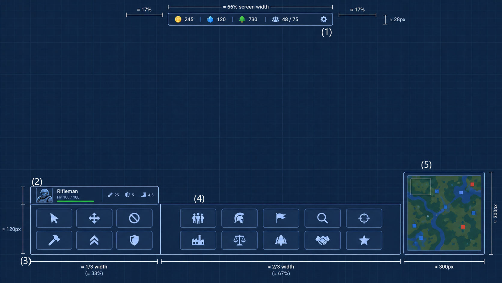
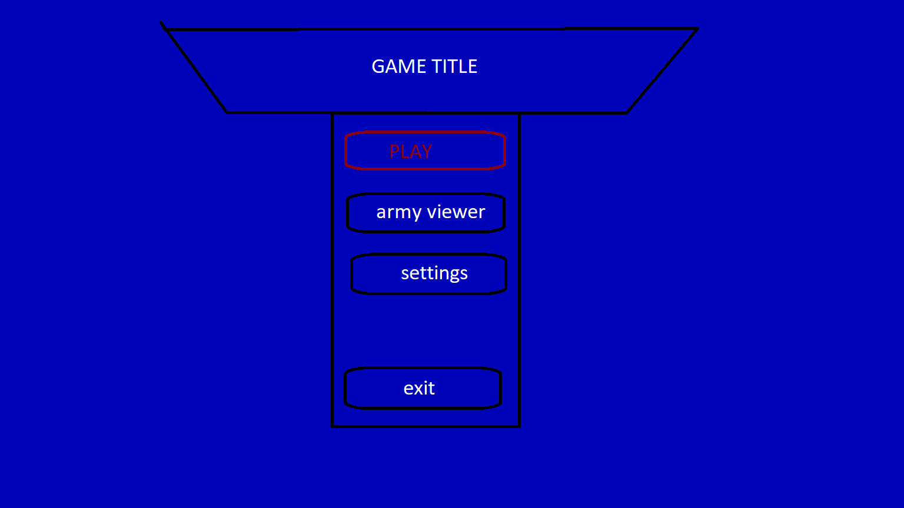

# Rugged Oil

*A 2d top down RTS.*

## Game niche

Moveable HQs as giant vehicles. Slow, tactical RTS gameplay. A unique post-apocalyptic, dieselpunk setting. Two asymmetrical factions with unique gameplay.

## Inspiration from

- Homeworld: Deserts of Kharak: futuristic post-apocalyptic desert setting, a large base vehicle at the start that produces everything else, no buildings, scale, tactical sense.
- Company of Heroes and Dawn of War: requisition points scattered across the map, captured by units.
- Battlefleet Gothic: Armada: slow, tactical vehicle combat with firing arcs, ranges, slow turn rates and tactical abilities.
- Sins of a Solar Empire: various ideas.

## Setting

The game is set in the near future, after an apocalypse. The whole world has turned into a vast desert, with ruins of the old world scavenged for oil. The survivors have formed factions, each vying for control of the most precious resource: oil. Oil fuels the monstrous vehicles that are the main means of transportation across the deserts, as well as each faction’s defence. Two distinct factions have grown stronger than most.

### Art Direction and Aesthetics

The game should have a futuristic, yet post apocalyptic look. Menus, widgets and the HUD are drawn with thin lines, light blue colors, creating a sleek, futuristic look, while the maps should be desert themed and orange toned.

Units are dieselpunk-mad max inspired, with the added touch of heavy steel, metal surfaces in the League, while raiders have more open-topped, buggy type vehicles. Black smoke erupts from the units’ exhausts, adding to the dieselpunk atmoshpere.

The league has treaded, slow vehicles, heavily armoured with steel plates and broad guns, while the raiders have faster, open topped bikes and trucks, thinner weapons and their vehicles are wheeled, their bigger vehicles having 6 to 8 wheels.

## Factions

There are two main factions in the game: the Raiders and the League. Both factions are playable.

The merciless Raiders started as a small band and now have members all over the deserts. Prone to their animalistic instincts, they preach freedom from progress and technology and a surrender to primal impulses. They use light vehicles armed with primitive weapons and armour. They harass enemy positions and, when the time is right, they charge in with their ramming vehicles. Their strengths are speed and strength of numbers (cheap units); their weaknesses are fragile vehicles, primitive weapons and no heavy armour. They mostly use wheeled vehicles.

The League is a stark contrast to the Raiders: slow, but heavily armoured and elite. They are dogmatic keepers of sacred tech. They have armoured vehicles and advanced weapons, and their units are more expensive. They mostly use tracked vehicles.

## Base vehicle (HQ)

Each faction begins the game with a base vehicle, its HQ. The HQ produces all other units and is where upgrades are bought. It is also the drop-off point for the League’s extractors. When a player’s HQ is destroyed, that player loses. This is the goal of the game: destroy the other player’s HQ.

Both HQs move slowly. HQs are lightly armed, with one pintle-mounted autocannon each, and their weapons can be upgraded. The HQ does not count towards the population cap.

At the start of the match, each player has only their HQ and some manpower. The HQ spawns at fixed locations, distinct for each map.

### Production

When the HQ is selected, every unit of its faction appears as a recruit button. All units are available from the start of the match:

- The cost is paid when the recruit button is pressed.
- Each unit type has its own recruit timer. When it ends, the unit spawns.
- Queue: up to 5 units can be queued. They are recruited one at a time.
- A queued unit can be cancelled, which refunds its full cost.
- The new unit spawns right next to the HQ, in the first free spot (if one side is blocked, it spawns on another side). There is no rally point.
- A unit cannot be recruited if it would exceed the population cap.

## Map

There will be various maps for 1v1 battles. The maps should be fairly large for a 1v1 RTS, to avoid alpha strikes and instant combat. They will have large obstacles in the form of boulders or ruins. Each map will have around 6–8 requisition points and a few scattered oil and metal reserves.

Unlike requisition points, oil and metal reserves are not gathered passively and require an extractor. League extractors carry the extracted oil or metal back to their HQ. Raiders extractors gather on the spot: the resource arrives over time, with no trip back.

- Reserves are finite. When a reserve runs out, players have to find another one. When all reserves of a resource are used up, there is no more of that resource.
- Each reserve covers a square of 60 × 60 m (6 × 6 tiles) on the map.
- Several extractors can work the same reserve at once.
- When a reserve runs out, its extractors stay in place (no automation).

### Requisition points

Requisition points work as in Dawn of War and Company of Heroes. Owning them increases manpower income.

- Any unit can capture a requisition point, but only with a capture order (select the unit and right-click the point). Driving through or idling near it does not capture it.
- The unit has to stay inside the capture area: a square of 80 × 80 m (8 × 8 tiles) centred on the point.
- Capturing takes 30 seconds for a single light unit.
- Capture weight: light units count as 1, medium units as 2 and heavy units as 5.
- More weight captures faster, but with small growth: capture speed = 1 + (weight − 1) ÷ 9. For example, weight 2 captures at ×1.1 and weight 10 at ×2.
- An enemy-owned point must first be neutralised (30 seconds), then captured (another 30 seconds).
- Contested point: when both sides have capturing units inside, the side with more weight captures, at the speed of the weight difference.
- If the units leave before the capture completes, the progress decays slowly for 10 seconds, then drops to zero.
- Manpower increases by 10 manpowers per second for each held requisition point for the controlling player.

For starters, we will create a single map with a png background and obstacles and other game objects will be added as sprites on top.

In regard to its size: 256 × 256 tiles. Each tile is 32 pixels, so the total map size is 8192 × 8192 px.

Background at half resolution (4096 × 4096) and scaled 2×.

### Fog Of War

The map is covered in fog of war: the player can’t see enemy units beyond their own units’ spotting range. This forces the players to always scout for enemy positions. Every unit in the game has a spotting range as a stat. Obstacles block vision. The fog of war should appear as a thin grey layer, not hiding the map underneath, only the enemy units.

## Economy

The following resources exist in the game:

- Manpower: gained from requisition points. It is a countable resource (e.g. a player has 300 manpower) which grows every second. Each player starts with a base income of 10 manpower per second, and each requisition point increases it by 10. Manpower is infinite. Players begin each game with 500 manpower each. Base income for both players (background income) 10 manpower/s.

- Oil: gathered only from oil reserves, by extractors. Used mainly in the production of vehicles and some upgrades. Finite. League extractors collect 15 oil per 1 minute and need to touch the HQ for the oil to be collected by the player. A League extractor carries at most 10 oil. Raider extractors gather it at a steady pace of 10 oil per 1 minute.

- Metal: gathered only from metal reserves, by extractors. Used mainly in the production of vehicles and some upgrades. Finite. League extractors collect 30 metal per 1 minute and need to touch the HQ for the metal to be collected by the player. A League extractor carries at most 15 metal. Raider extractors gather it at a steady pace of 20 metal per 1 minute.

*If a league extractor is destroyed during transit, the resource gathered is lost and not collected.

*each oil reserve holds 100 oil. Each Metal reserve holds 150 metal

**Population:** each player has a hard population cap of 100, which never grows. Light units use 1 population, medium units 2 and heavy units 5. The HQ does not count.

## Units

All units in the game have the following stats:

- Armour (front)
- Armour (side)
- Armour (rear)
- Spotting range
- Health
- Acceleration
- Top speed
- Rotation speed (hull, not the weapons)
- Type (e.g. medium tank, HQ, extractor)
- Size class: light, medium or heavy (sets its population cost and capture weight)
- Cost (manpower, oil, metal) and recruit time

Each weapon in the game has the following stats:

- Damage
- Piercing
- Range
- Projectile speed
- Rate of fire
- Maximum projectile distance

Each weapon sits on a mount. Each mount type has the following stats:

- Arc (in degrees)
- Rotation speed

### Unit Types

Combat vehicles

Tanks

extractors

## Combat

The combat works as follows:

A unit automatically shoots the closest visible enemy unit within its weapons’ range, if it has a clear line of fire. It aims based on the target’s last known location, facing and speed. This means that some shots may miss if the enemy unit changes its movement while the projectile travels.

Each vehicle’s weapon turns to face the enemy unit if its firing arc allows it. The vehicle itself never moves on its own. **Idle vehicles turn toward the closest visible attacker**, while **moving vehicles don’t**, so they keep driving.

Right-clicking an enemy unit orders an attack: the unit drives into range if needed, then fires. This overrides “target the closest enemy”.

**Piercing**: the percentage of the damage that passes through armour. E.g. a piercing value of 50 means 50% of the shot’s damage ignores armour.

**Armour**: the percentage of damage that is blocked from an incoming attack (e.g. armour 50 blocks 50% of the incoming damage), after piercing damage has been calculated and applied.

For damage calculation, the formula is:

- First, the piercing damage is calculated and goes through.
- The rest of the damage is calculated against the enemy’s armour, and the result is applied.

Projectiles and line of fire:

- Obstacles block shots and vision.
- A projectile flies until it hits an enemy unit (any enemy in its path, not only its target), hits an obstacle, or reaches its maximum distance.
- Projectiles pass through friendly units. There is no friendly fire.
- There is no splash damage. Every shot hits a single target.

## Unit behaviour

There is very little automation in the game: the player is in control.

- Player units never move on their own. They behave as if always holding position.
- They automatically fire at visible enemies within weapon range.
- When attacked, an idle unit turns toward the closest visible attacker. Moving units don’t turn. If the attacker is in the fog of war, the unit doesn’t react at all.
- An outranged unit simply takes the hits: positioning is the player’s job.
- Extractors keep working when attacked.

Basic actions:

- **Move**: drive to the point.
- **Stop**: cancel the current order and queued orders. The unit stays in place.
- **Attack-move**: drive toward the point; stop and fight when a visible enemy comes within range; continue when no enemy is left in range.
- **Hold fire**: the unit doesn’t fire automatically.

## Controls

- Left-click to select a unit, drag a box to select several. Hold Shift to add to the selection.
- Right-click to give the default order (move, attack an enemy, capture a requisition point, gather from a reserve).
- Shift + right-click queues orders.
- Control groups: Ctrl + 1–9 to assign, 1–9 to select.
- Camera: screen edges, WASD and mouse wheel zoom.
- Clicking the minimap moves the camera.

## Upgrades

Upgrades are bought at each faction’s HQ. Some upgrades affect a specific type of unit, others affect the faction as a whole. Upgrades cost resources.

For unit upgrades that are not applied automatically, the upgrade must first be researched at the HQ. It then becomes available as a button when selecting the type of unit the upgrade was meant for. Both the research and the application of the upgrade cost resources: once for the research at the HQ, then for each unit independently. Not all units of the same type have to apply the upgrade.

Upgrades affecting the faction as a whole or the HQ itself don’t need to be applied: they are active immediately after the research.

Unit stats or resource stats change accordingly once an upgrade has been applied or is active.

## HUD

Here is a labelled blueprint of the in-game HUD:

(All icons, symbols, names and numbers are for blueprint purposes only.)

- The top bar. It extends over ⅔ of the top edge, leaving empty space at both ends. It shows the 3 resources (manpower, oil, metal) side by side, each with its symbol and current amount. On the right side is the population (x/100). On the far right is a Settings button.
- The unit inspector rectangle. It only appears when a unit is selected. It displays the selected unit’s icon and its stats, each stat as a symbol followed by its value. The HP bar is green and thin, with the current and max value shown on top. When several units are selected (including by drag-select), it shows only the first selected unit.
- The basic actions rectangle. It extends into the advanced actions rectangle, split by a thin vertical line ⅓ of the way across. The basic actions (Move, Stop, Attack-move, Hold fire) are displayed as symbols on square buttons, in a 2×2 arrangement.
- The advanced actions rectangle. Same style as the basic actions rectangle, but with a 6×2 arrangement (it takes the 2 slots freed from the basic actions). The advanced action buttons depend on the selected unit: some units have special abilities with their own buttons, which appear only when that unit is selected. When the HQ is selected, this area shows its recruit buttons and upgrades.
- The minimap. It’s a rectangle, slightly taller than the actions rectangles, reaching the same height as the unit inspector rectangle when that is visible.
  - It shows obstacles, resource reserves (each with its resource symbol) and requisition points, without fog.
  - Units: friendly units are blue dots, enemy units are red dots (only those currently visible). The HQs are bigger dots.
  - Requisition points: blue, with the player’s own points in a lighter blue.

### Indicators

When a selected unit has an order (move, attack, capture, gather, etc.), a very thin indicator line is drawn from the unit to its target. The line is bright light blue for move, red for attack and yellow for gather.

### Highlights

Along with the indicator, selected units are highlighted with a thin, bright light blue rectangle around the unit’s sprite.

## Menus

### Main Menu

When the game loads, the main menu appears. Here’s an illustration of what it should look like:

(All colours and words are indicative; all lines and shapes should be aligned correctly. This is just an example.)

The menu shows the game’s title and 4 buttons. The background is just a colour for now. The buttons are:

- Play (opens the match setup screen)
- Army viewer (will do nothing for now)
- Settings (will do nothing for now)
- Exit

### Match setup

After clicking Play, the player selects the map, their faction and the enemy faction, and presses Start.

### Escape Menu

While in a match, pressing the Settings button or the Esc key pauses the game and opens the escape menu in the middle of the screen. Pressing Esc again closes it. It has 2 buttons:

- Settings
- Exit

### End of match

When a player’s HQ is destroyed, the match ends: the winner sees a victory screen and the loser a defeat screen. Clicking Exit returns to the main menu. There is no surrender button: Exit in the escape menu serves the same purpose.

## AI opponent

- Matches are 1v1 against the AI. There is one difficulty level.
- The AI cheats with bonus income: +25% on all its resource income (manpower, oil and metal), to keep the AI simple to build.
- It plays by the same rules otherwise: it captures requisition points, gathers and attacks the player’s HQ.

## Appendix

Tables with data for units, weapons, mounts, upgrades, costs, recruit times, extraction rates, damage values, etc.

### The League Units & Upgrades

The League Units:

| Name | Dreadnought | Sentinel | Steward | knight | lifeline | Retributor |
|---|---|---|---|---|---|---|
| Type | HQ | scout | Combat vehicle | Medium tank | extractor | Heavy tank |
| Armour (front) | 80 | 20 | 20 | 50 | 20 | 70 |
| Armour (side) | 60 | 10 | 20 | 40 | 10 | 60 |
| Armour (rear) | 60 | 10 | 10 | 40 | 10 | 60 |
| health | 10000 | 750 | 1250 | 1500 | 2500 | 2500 |
| Spotting range | 300 | 300 | 200 | 200 | 200 | 200 |
| Top speed (m/s) | 15 | 40 | 30 | 25 | 20 | 20 |
| acceleration | 1 | 3 | 3 | 2 | 1.5 | 2 |
| Rotation speed | 15 | 45 | 45 | 30 | 15 | 30 |
| Size class | - | light | light | medium | medium | heavy |
| Cost (manpower) | - | 100 | 250 | 300 | 250 | 700 |
| Cost (oil) | - | 0 | 15 | 20 | 0 | 50 |
| Cost (metal) | - | 0 | 5 | 30 | 0 | 100 |
| Weapon 1 (mount) | Autocannon (pintle) | - | Autocannon (turret) | Peacemaker (turret) | Autocannon (armoured) | Peacemaker (turret) |
| Weapon 2 (mount) | - | - | - | - | - | Twin autocannon(armoured) |
| Recruit time (seconds) | - | 5 | 10 | 15 | 20 | 35 |

The league Upgrades (upgrades take 1 minute to research):

| Upgrade name | Applies to | effect | Cost (mp) | Cost (oil) | Cost (metal) | Apply cost |
|---|---|---|---|---|---|---|
| Aggressive recon | Sentinel | Adds 1x autocannon to the sentinel | 200 | 0 | 10 | 25 manpower |
| Knightly Vows | Knight | Replaces peacemaker (turret) weapon with pacifier (turret) weapon | 300 | 10 | 20 | free |
| Brace | Faction wide | All vehicles gain +10 armour to all sides | 700 | 10 | 50 | Free - applies automatically (newly recruited ones as well) |

### The Raiders Units & Upgrades

| Name | Ravager | Spotter | Hunter | Raider | Gatherer | Destroyer |
|---|---|---|---|---|---|---|
| Type | HQ | scout | Light combat vehicle (bike) | combat vehicle | extractor | Heavy combat vehicle |
| Armour (front) | 60 | 0 | 10 | 30 | 10 | 50 |
| Armour (side) | 60 | 0 | 10 | 30 | 10 | 50 |
| Armour (rear) | 50 | 0 | 10 | 20 | 10 | 50 |
| health | 10000 | 500 | 1000 | 1500 | 2500 | 3000 |
| Spotting range | 300 | 300 | 200 | 200 | 200 | 200 |
| Top speed(m/s) | 18 | 45 | 45 | 37 | 20 | 30 |
| acceleration | 2 | 3 | 2 | 2 | 2 | 2 |
| Rotation speed | 15 | 45 | 45 | 45 | 30 | 30 |
| Size class | - | light | light | medium | medium | heavy |
| Cost (manpower) | - | 50 | 250 | 300 | 250 | 700 |
| Cost (oil) | - | 0 | 5 | 20 | 0 | 50 |
| Cost (metal) | - | 0 | 5 | 30 | 0 | 100 |
| Weapon 1 | Autocannon (pintle) | - | Twin autocannon (pintle) | Flaming spear (turret) | Autocannon (turret) | Harpoon (pintle) |
| Weapon 2 | - | - | - | - | - | Flaming spear (turret) |
| Recruit time (s) | - | 5 | 10 | 15 | 15 | 30 |

Raiders Upgrades (upgrades take 1 minute to research):

| Upgrade name | Applies to | effect | Cost (mp) | Cost (oil) | Cost (metal) | Apply cost |
|---|---|---|---|---|---|---|
| Tactical gatherer | Gatherer | Replaces autocannon(turret) with Twin autocannon(turret) | 300 | 0 | 0 | Applies automatically to all (newly recruited ones as well) |
| Combat Raider | Raider | Raider gains +10 armour on all fronts | 300 | 0 | 20 | Applies automatically to all (newly recruited ones as well) |
| Faster, Faster! | Faction wide | All vehicles gain +10 top speed and + 0.5 acceleration | 700 | 30 | 20 | Applies automatically to all (newly recruited ones as well) |

### Unit sizes

Default size per size class, seen from above, facing right (1 tile = 10 m = 32 px). A unit may
override its class size later.

| Size class | Length × width | On screen (100% zoom) | Sprite size (drawn at 2×) | Units |
|---|---|---|---|---|
| Light | 8 × 4 m | 26 × 13 px | 52 × 26 px | Sentinel, Steward, Spotter, Hunter |
| Medium | 12 × 6 m | 38 × 19 px | 76 × 38 px | Knight, Lifeline, Raider, Gatherer |
| Heavy | 16 × 8 m | 51 × 26 px | 102 × 52 px | Retributor, Destroyer |
| HQ | 40 × 24 m | 128 × 77 px | 256 × 154 px | Dreadnought, Ravager |

Map gaps must be at least 3 tiles wide for HQs to pass.

### Weapons & mountings

Weapons:

| Name | Type (ignore) | Range (meters) | Rate of Fire (per second) | damage | piercing | Projectile speed | Max projectile distance |
|---|---|---|---|---|---|---|---|
| autocannon | slug | 150 | 2/s | 50 | 5 | 100m/s | 200m |
| pacifier | slug | 100 | 0.5/s | 200 | 30 | 75m/s | 100m |
| peacemaker | slug | 250 | 0.3/s | 500 | 50 | 80m/s | 300m |
| Twin autocannon | slug | 150 | 4/s | 50 | 10 | 100m/s | 200m |
| Flaming spear | slug | 75 | 0.5/s | 250 | 50 | 100m/s | 125m |
| harpoon | slug | 200 | 0.5/s | 40 | 60 | 75m/s | 300m |

Mounts

| Name | Firing arc | Rotation speed(s) |
|---|---|---|
| armored mount | 30 | 30/s |
| Pintle mount | 90 | 45/s |
| Turret mount | 360 | 90/s |
